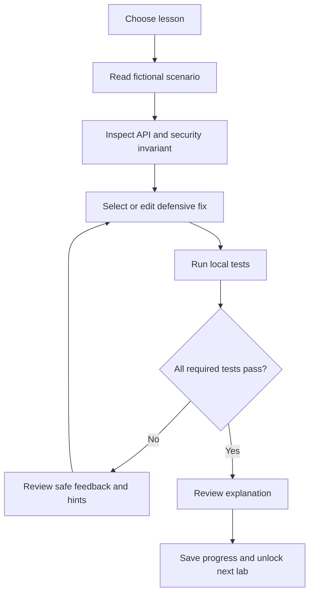
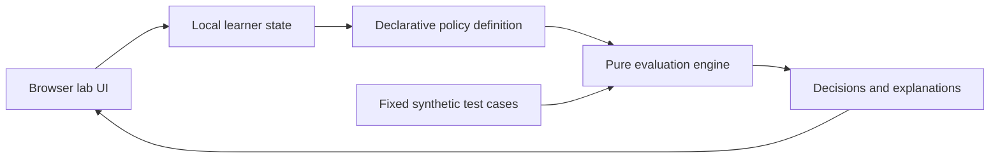
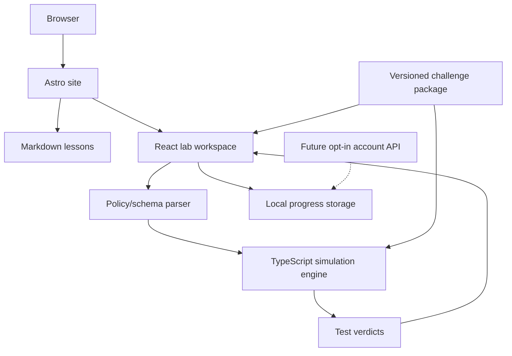
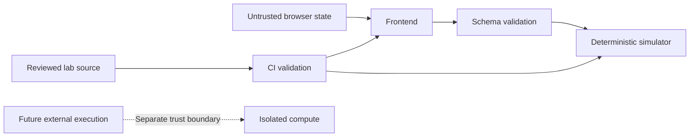
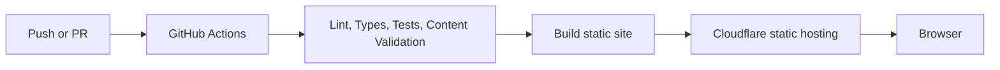

# SecureLab — Interactive API Security Academy

> **Tagline:** Break assumptions. Fix APIs. Prove security.
>
> **Document:** Product Requirements Document (PRD) + Technical Design Document (TDD) + Implementation Roadmap  
> **Version:** 1.0  
> **Status:** Proposed / ready for implementation  
> **Updated:** 2026-11-19  
> **Audience:** Software engineers, backend developers, students, security-minded teams, open-source contributors

---

## Table of Contents

1. [Executive Summary](#1-executive-summary)
2. [Vision, Mission, and Principles](#2-vision-mission-and-principles)
3. [Problem, Audience, and Positioning](#3-problem-audience-and-positioning)
4. [Goals, Non-Goals, and Success Metrics](#4-goals-non-goals-and-success-metrics)
5. [Product Experience and Gameplay Loop](#5-product-experience-and-gameplay-loop)
6. [Curriculum and Challenge Catalog](#6-curriculum-and-challenge-catalog)
7. [The First Six MVP Labs](#7-the-first-six-mvp-labs)
8. [Lab Content Schema](#8-lab-content-schema)
9. [Lesson, Hint, Assessment, and Scoring Design](#9-lesson-hint-assessment-and-scoring-design)
10. [API Simulator and Sandbox Model](#10-api-simulator-and-sandbox-model)
11. [Architecture and Technology Stack](#11-architecture-and-technology-stack)
12. [Frontend UX and Information Architecture](#12-frontend-ux-and-information-architecture)
13. [Backend and Data Architecture](#13-backend-and-data-architecture)
14. [Security and Abuse-Prevention Requirements](#14-security-and-abuse-prevention-requirements)
15. [Accessibility, Privacy, and Performance](#15-accessibility-privacy-and-performance)
16. [Repository Layout and Package Interfaces](#16-repository-layout-and-package-interfaces)
17. [Testing and Quality Assurance](#17-testing-and-quality-assurance)
18. [Content Authoring and Review Workflow](#18-content-authoring-and-review-workflow)
19. [MVP Definition and Acceptance Criteria](#19-mvp-definition-and-acceptance-criteria)
20. [Implementation Roadmap](#20-implementation-roadmap)
21. [Deployment, Observability, and Operations](#21-deployment-observability-and-operations)
22. [Open Source, License, and Community](#22-open-source-license-and-community)
23. [Future Features and Business Model](#23-future-features-and-business-model)
24. [Risks, Trade-offs, and Open Questions](#24-risks-trade-offs-and-open-questions)
25. [Milestones and Task Checklist](#25-milestones-and-task-checklist)
26. [Architecture Decision Records](#26-architecture-decision-records)
27. [Reference Resources](#27-reference-resources)

---

## 1. Executive Summary

**SecureLab** is a browser-based, hands-on educational game for learning API security. Each lab presents a fictional application with a security mistake, simulated requests and responses, a focused piece of backend code, and a set of secure-behavior requirements. Learners inspect the problem, choose or implement a defensive correction, run deterministic validation tests, and receive an explanation of why the fix works.

The initial release is a **safe, offline-capable simulated environment** rather than a hosted collection of intentionally vulnerable internet-accessible servers. No lab should permit arbitrary outbound networking or attacks against third-party systems. Training scenarios use fictional organizations, sample data, and synthetic identifiers.

### Product in one sentence

> A Duolingo-like progression system meets a miniature API development environment, with strong explanations and verifiable secure-code tests.

### What a user can do in the MVP

- Pick a beginner-friendly API security lab.
- Read a short scenario and inspect a fictional API contract.
- Observe illustrative request/response traces from a deterministic simulator.
- View and edit a limited portion of TypeScript defensive code, or select one of several candidate fixes.
- Run a test suite against authorization, input validation, and boundary conditions.
- See pass/fail test results, a policy decision trace, and a concise security explanation.
- Unlock the next lab and keep progress locally without an account.

### Product differentiators

1. **Fix-first pedagogy:** Training rewards prevention and verification, not merely finding a flaw.
2. **API-centered:** Focus on resource access, identities, permissions, data exposure, and integration boundaries.
3. **No giant infrastructure bill:** The MVP runs as a static-first application with deterministic tests.
4. **Explainable assessment:** Each test maps to a written security invariant.
5. **Built by developers for developers:** Strong TypeScript ergonomics, reusable packages, and contributor-friendly lab definitions.
6. **Progressively realistic:** Start with a small REST API; advance to multi-tenant services and business workflows.

---

## 2. Vision, Mission, and Principles

### Vision

Every backend developer should be able to reason about API security before deploying code to production.

### Mission

Teach developers to recognize insecure design assumptions, implement secure API patterns, and validate those patterns through repeatable tests.

### Product principles

- **Safe by construction.** Exercises use an in-memory model and controlled fixtures, not reachable vulnerable services.
- **Explain the why.** Every verdict connects code behavior with a threat, a trust boundary, and a defensive principle.
- **Teach transferable reasoning.** Avoid solutions that only work for one hard-coded example.
- **Prefer short feedback loops.** Read a scenario, make a change, run tests, and learn within minutes.
- **Respect the learner.** Use encouraging explanations rather than shame or misleading scare tactics.
- **Keep content versioned.** Labs, tests, explanations, and answer criteria change through reviewed pull requests.
- **Accessible without signup.** Core education is public, with local progress as the default.

### Brand direction

- **Name:** SecureLab
- **Subtitle:** Interactive API Security Academy
- **Suggested domain candidates:** Check availability before registering; no domain is reserved by this document.
- **Design tone:** Calm, precise, technical, developer-focused.
- **Visual cues:** Dark IDE surfaces, restrained green/amber/red feedback, clear typography, compact panels, subtle grid patterns.
- **Avoid:** Glorifying hacking, cinematic attack effects, implying real systems were compromised.

---

## 3. Problem, Audience, and Positioning

### Problems

- Many developers learn authentication without understanding authorization.
- Developers may know vulnerability names but struggle to implement robust checks.
- Passive reading rarely proves that someone can make secure code changes.
- Existing security training can require setup, dedicated machines, or risky internet-facing lab environments.
- Junior engineers often lack examples of tenant isolation, property-level permissions, and secure service-to-service API consumption.

### Primary users

| Persona | Needs | SecureLab value |
|---|---|---|
| Junior backend developer | Learn HTTP, auth, permissions | Guided introductory labs |
| Full-stack TypeScript developer | Secure real REST APIs | Fix-focused code exercises |
| Interview candidate | Practice explaining decisions | Structured concepts and review questions |
| Engineering mentor | Assign practical exercises | Shareable challenge URLs and objectives |
| Self-directed student | Progress with low setup friction | Browser-based, no account required |

### Positioning statement

For developers who want practical API security skills, SecureLab is an interactive learning platform that transforms common API mistakes into short, verifiable defensive coding challenges, without requiring a vulnerable public server or security-tool setup.

### Comparable experiences (inspiration only)

- Coding-exercise editors: immediate validation and code feedback.
- Educational games: level progression and clear goals.
- Documentation portals: accurate, linked security references.
- API client interfaces: request, response, and status visualization.

SecureLab is **not** an unrestricted penetration-testing environment or a service for evaluating websites without authorization.

---

## 4. Goals, Non-Goals, and Success Metrics

### Initial product goals

1. Publish a polished, functional educational site.
2. Ship six complete labs with realistic secure-code decisions.
3. Make the assessment engine deterministic and testable.
4. Keep the core experience accessible without authentication.
5. Publish the simulator and challenge schema as reusable TypeScript packages.
6. Provide a clear contribution workflow for new labs.

### Explicit MVP non-goals

- Scanning real websites or remote APIs.
- General-purpose interception proxies.
- Arbitrary user-supplied network destinations.
- Public, intentionally vulnerable servers.
- Real credential handling or authentication attacks.
- Running arbitrary user code with unrestricted Node.js permissions.
- Competitive ranked leaderboards based on exploit speed.
- AI-generated code execution, automated exploit chains, or external target discovery.
- Production-grade security certification or guaranteed assessment of a person's skills.

### Proposed launch KPIs (targets, not forecasts)

| Metric | MVP target | How measured |
|---|---:|---|
| Complete first lab | >= 50% of starters | Opt-in aggregate analytics |
| Complete all six labs | >= 15% of starters | Opt-in aggregate analytics |
| Median time to first feedback | < 2 minutes | Local instrumented timing |
| Typical client-side test run | < 500 ms on reference device | Automated benchmark |
| Browser accessibility | WCAG 2.2 AA design target | Audit + manual checks |
| Core lab test reliability | 100% deterministic in CI | Snapshot and unit tests |
| Initial content | 6 reviewed labs | Repository metadata |

**Privacy note:** Metrics must not require identifying individual learners. Do not transmit editor contents or simulated request payloads to analytics.

---

## 5. Product Experience and Gameplay Loop

### Main learning loop



### Challenge anatomy

Each lab contains:

1. Title and difficulty.
2. Estimated learning time.
3. Prerequisites and learning objectives.
4. Fictional application scenario.
5. API contract or route summary.
6. Existing code or policy logic.
7. Desired secure-behavior requirements.
8. Editable defensive implementation region or multiple-choice fix set.
9. Simulated interactions and response previews.
10. Public tests plus hidden *defensive regression cases* where applicable.
11. Hints with increasing specificity.
12. Completion explanation and recommended further reading.

### Core progression

**Explore → Understand → Repair → Verify → Reflect**.

### Modes

- **Guided:** Visible objectives, generous hints, explicit policy rules.
- **Practice:** Reduced hints, multiple scenarios, replayable exercises.
- **Review (future):** Short concept questions and secure-code comparisons.

### Progress experience

- Curriculum map with completed, active, and locked levels.
- Topic badges (e.g., Authorization Basics) rather than prestige-based hacking ranks.
- Review cards summarizing key takeaways.
- Optional “retry without hints” mode for self-checking.

---

## 6. Curriculum and Challenge Catalog

The curriculum is aligned with the **OWASP API Security Top 10 (2023)**, augmented with foundational secure engineering topics. The OWASP Top 10 for web applications is a separate publication with a 2025 release; avoid confusing the two lists.

### Module A — Foundations

| ID | Lab | Difficulty | Primary objective |
|---|---|---|---|
| A01 | Who Am I? | Beginner | Understand authentication identity vs authorization decisions |
| A02 | The Missing Permission Check | Beginner | Enforce ownership checks for resource reads |
| A03 | Roles Are Not Objects | Beginner | Differentiate role permissions from resource permissions |
| A04 | Valid Inputs, Safe Defaults | Beginner | Add schema validation and reject malformed data |

### Module B — Authorization and Isolation

| ID | Lab | Difficulty | Primary objective |
|---|---|---|---|
| B01 | Tenant Boundary | Beginner | Scope data by authenticated tenant |
| B02 | Field-Level Privacy | Intermediate | Restrict sensitive response properties |
| B03 | Function-Level Permission | Intermediate | Limit privileged routes with explicit permissions |
| B04 | Safe Record Updates | Intermediate | Prevent accidental assignment to protected fields |
| B05 | Ownership Changes | Intermediate | Check permissions before and after business transitions |

### Module C — Authentication and Sessions

| ID | Lab | Difficulty | Primary objective |
|---|---|---|---|
| C01 | Token Claims Are Not Enough | Beginner | Validate token provenance and expected claims conceptually |
| C02 | Session Lifecycles | Intermediate | Handle expiration and revocation states |
| C03 | Credential Recovery Design | Intermediate | Build safe recovery flows with generic responses |
| C04 | API Keys and Scopes | Intermediate | Apply least privilege to service identities |

### Module D — Resource and Business Protections

| ID | Lab | Difficulty | Primary objective |
|---|---|---|---|
| D01 | Pagination Limits | Beginner | Bound page size and server workload |
| D02 | Quota Policy | Intermediate | Design reasonable per-identity request budgets |
| D03 | Replay-Safe Orders | Intermediate | Model idempotency keys in a fictional order API |
| D04 | Sensitive Workflow Approval | Advanced | Require state-based authorization for business actions |

### Module E — Configuration and API Integrations

| ID | Lab | Difficulty | Primary objective |
|---|---|---|---|
| E01 | Safe Error Responses | Beginner | Separate public error messages from internal details |
| E02 | Third-Party Data Is Untrusted | Intermediate | Validate external service responses before use |
| E03 | Controlled URL Fetching | Intermediate | Use fixed destinations and URL allowlists in mock services |
| E04 | Legacy API Inventory | Intermediate | Identify unsupported or undocumented version risks |

### Module F — Architecture and Capstones

| ID | Lab | Difficulty | Primary objective |
|---|---|---|---|
| F01 | Policy Matrix | Intermediate | Implement role, relationship, and tenant access tests |
| F02 | Audit Events | Intermediate | Record meaningful security events without storing secrets |
| F03 | Secure Ticket Service | Advanced | Combine object permissions, field controls, and validation |
| F04 | Multi-Tenant Workspace | Advanced | Build a defensible multi-tenant policy model |

**Total planned labs:** 24. **Initial MVP:** six carefully reviewed labs drawn from these topics.

### Mapping to the API Top 10 (2023)

| OWASP category | Relevant SecureLab lessons |
|---|---|
| API1 Broken Object Level Authorization | A02, B01, B05, F01 |
| API2 Broken Authentication | A01, C01, C02, C03 |
| API3 Broken Object Property Level Authorization | B02, B04, F03 |
| API4 Unrestricted Resource Consumption | D01, D02 |
| API5 Broken Function Level Authorization | A03, B03 |
| API6 Unrestricted Access to Sensitive Business Flows | D03, D04 |
| API7 Server Side Request Forgery | E03 (defensive URL-policy simulation only) |
| API8 Security Misconfiguration | E01, F02 |
| API9 Improper Inventory Management | E04 |
| API10 Unsafe Consumption of APIs | E02 |

The mapping is an educational guide, not a claim that each lab exhaustively covers the associated risk.

---

## 7. The First Six MVP Labs

### MVP-01 — Authentication Is Not Authorization

- **Scenario:** A sample project management API authenticates a user but does not establish their permission to read a specific project.
- **Route:** `GET /api/projects/:projectId`
- **Task:** Add a resource access rule based on authenticated identity and membership.
- **Defensive invariant:** The resource is returned only when the requester's verified identity has a permitted relationship with the project.
- **Teaching point:** A valid session alone does not authorize access to every object.
- **Expected duration:** 8–12 minutes.
- **Pass cases:** Member reads accessible project; nonmember receives a consistent denial; unknown project does not disclose restricted details.

### MVP-02 — Tenant Isolation

- **Scenario:** Two fictional organizations share the same database, and an endpoint filters only by document ID.
- **Route:** `GET /api/documents/:documentId`
- **Task:** Require tenant-scoped lookup and tenant-matched authorization.
- **Defensive invariant:** Results from one tenant are never returned to another tenant.
- **Teaching point:** Scope database queries by trusted tenant context rather than a tenant ID supplied by the requester.
- **Expected duration:** 10–15 minutes.

### MVP-03 — Role vs Permission

- **Scenario:** A helpdesk API exposes a ticket administration action intended only for authorized supervisors.
- **Route:** `POST /api/tickets/:ticketId/close`
- **Task:** Implement explicit permission checks and business-state validation.
- **Defensive invariant:** A user must have the required action permission **and** satisfy the ticket's scope rules.
- **Teaching point:** A role label alone does not express every relevant authorization condition.
- **Expected duration:** 10–15 minutes.

### MVP-04 — Property-Level Authorization

- **Scenario:** A profile endpoint returns the entire database object, including fields that should remain private.
- **Route:** `GET /api/profiles/:id`
- **Task:** Replace unrestricted object serialization with an explicit public response model.
- **Defensive invariant:** Response schemas contain only fields explicitly allowed for the current audience.
- **Teaching point:** Correct object access does not necessarily justify exposing every property.
- **Expected duration:** 8–12 minutes.

### MVP-05 — Validate Inputs and Limit Work

- **Scenario:** A search endpoint accepts arbitrary pagination sizes and poorly validated query shapes.
- **Route:** `GET /api/items?page=...&pageSize=...`
- **Task:** Apply strict input parsing, bounds, and predictable errors.
- **Defensive invariant:** Request parameters are validated, pagination is bounded, and the server does not perform unbounded work.
- **Teaching point:** Resource consumption is a security as well as a reliability concern.
- **Expected duration:** 8–12 minutes.

### MVP-06 — Least-Privilege Capstone

- **Scenario:** A fictional workspace API supports document reads, edits, and sharing with tenant and role constraints.
- **Routes:** `GET /api/workspaces/:id/docs`, `PATCH /api/docs/:id`, `POST /api/docs/:id/share`
- **Task:** Complete a small policy module that decides read, edit, and share operations.
- **Defensive invariant:** Every action is authorized against the verified identity, the scoped resource, and the requested operation.
- **Teaching point:** Secure APIs are built from consistent policies rather than one-off route checks.
- **Expected duration:** 20–30 minutes.

### Example assessment rubric for MVP-02

| Scenario | Expected behavior | Weight |
|---|---|---:|
| Authenticated user reads own tenant's document | Allow | 20 |
| User requests a document in another tenant | Deny | 30 |
| Document identifier is missing | Safe not-found behavior | 10 |
| Client sends a different tenant identifier | Do not trust it | 25 |
| User has no verified tenant membership | Deny by default | 15 |

**Important:** Learners should not be given unrestricted access to a live vulnerable tenant API. All identities, resources, and policy decisions are synthetic fixtures.

---

## 8. Lab Content Schema

### Design goals

- Type-safe and independently versioned.
- Authorable as structured JSON/YAML plus Markdown prose.
- Portable between a static site and later hosted platform.
- Includes prerequisite and curriculum metadata.
- Separates learner-visible tests from trusted validation specifications.
- Supports multiple localized explanations in the future.

### Proposed types

```ts
export type Difficulty = 'beginner' | 'intermediate' | 'advanced';
export type LabMode = 'choose-fix' | 'policy-editor' | 'code-repair';

export interface LabDefinition {
  id: string;
  slug: string;
  version: number;
  title: string;
  description: string;
  module: string;
  difficulty: Difficulty;
  estimatedMinutes: number;
  prerequisites: string[];
  objectives: string[];
  references: Array<{ title: string; url: string }>;
  mode: LabMode;
  scenario: {
    appName: string;
    backgroundMarkdown: string;
    routeSummaries: Array<{
      method: 'GET' | 'POST' | 'PATCH' | 'PUT' | 'DELETE';
      path: string;
      purpose: string;
    }>;
  };
  editor: {
    language: 'typescript';
    starterCode: string;
    editableRegionId: string;
  };
  requirements: string[];
  hints: Array<{ tier: 1 | 2 | 3; contentMarkdown: string }>;
  visibleTestIds: string[];
  validatorId: string;
  explanationMarkdown: string;
  securityCategoryIds: string[];
}

export interface EvaluationResult {
  labId: string;
  passed: boolean;
  score: number;
  tests: Array<{
    id: string;
    name: string;
    passed: boolean;
    message: string;
  }>;
  feedback: string[];
  elapsedMs: number;
}
```

### Example lab metadata (abbreviated)

```yaml
id: MVP-02
slug: tenant-isolation
version: 1
title: Tenant Isolation
description: Keep documents within their owning workspace.
module: authorization
mode: choose-fix
difficulty: beginner
estimatedMinutes: 12
prerequisites:
  - MVP-01
objectives:
  - Explain why tenant IDs supplied by clients are untrusted
  - Enforce resource isolation using verified tenant context
  - Recognize deny-by-default behavior
visibleTestIds:
  - member-can-read-owned-document
  - foreign-tenant-denied
validatorId: tenant-isolation-v1
securityCategoryIds:
  - API1:2023
```

### Validation rules for content authors

- IDs and slugs must be unique.
- Prerequisites must exist and form an acyclic graph.
- All references must be valid and reviewed.
- Every lab must have a documented invariant and at least three meaningful cases.
- Tests must be stable and free of external network or clock dependencies.
- All synthetic records must be explicitly labeled fictional.
- No submitted community lab may run arbitrary shell commands or remote URLs.

---

## 9. Lesson, Hint, Assessment, and Scoring Design

### Evaluation philosophy

Assess **the behavior of the resulting policy**, not just its textual appearance. A learner should not get full credit merely because their solution includes a specific keyword or reproduces an exact reference snippet.

### MVP-safe assessment modes

1. **Choose-fix:** Select among reviewed defensive implementations and explain the choice. Fully deterministic, safest initial approach.
2. **Policy-editor:** Modify a small declarative access policy rather than unrestricted executable code.
3. **Code-repair (later):** Edit a tightly controlled TypeScript function, evaluated in a genuinely isolated sandbox with no network/filesystem privileges.

### Scoring proposal

- Security behavior: **70 points**.
- Completeness across boundary cases: **20 points**.
- Written reasoning or explanation check: **10 points**.
- Total: **100 points**.

Hints should help a learner progress but should **not** cause the system to imply that a passing result is invalid. Store `hintsUsed` separately from behavioral correctness. Display a completion summary with both.

### Scoring example

```ts
export function calculateScore(input: {
  passedSecurityWeight: number; // 0..70
  passedCoverageWeight: number;  // 0..20
  reasoningWeight: number;       // 0..10
}): number {
  const { passedSecurityWeight, passedCoverageWeight, reasoningWeight } = input;
  return Math.max(0, Math.min(100,
    passedSecurityWeight + passedCoverageWeight + reasoningWeight
  ));
}
```

### Feedback contract

A failed test should report:

- The security expectation.
- The observed *simulated* behavior.
- Why the difference matters.
- A conceptual hint for the next correction.

Avoid giving the user a copyable real-world exploitation walkthrough. Concentrate on authorized, synthetic cases and corrected policies.

### Hints

- **Tier 1:** Identify the governing concept (e.g., ownership vs authentication).
- **Tier 2:** Identify where the check belongs in the application flow.
- **Tier 3:** Show a small, reviewed defensive example or explain the expected invariant.

### Completion screen

- Score and security invariant results.
- Before/after policy visualization.
- A brief “what you learned” explanation.
- Common mistakes and why they fail.
- Links to accurate primary references.
- Next available challenge.

---

## 10. API Simulator and Sandbox Model

### MVP: deterministic policy simulator

The first version **does not execute arbitrary user-supplied JavaScript**. Instead, it runs versioned policy specifications and test fixtures through a pure TypeScript decision engine.



### Suggested policy model

```ts
export type Action = 'read' | 'edit' | 'share' | 'delete';

export interface Identity {
  id: string;
  verifiedTenantId: string | null;
  roles: string[];
}

export interface Resource {
  id: string;
  tenantId: string;
  ownerId: string;
  visibility: 'private' | 'team';
}

export interface AccessRequest {
  identity: Identity | null;
  resource: Resource | null;
  action: Action;
}

export function canReadDocument(request: AccessRequest): boolean {
  const { identity, resource, action } = request;
  if (!identity || !resource || action !== 'read') return false;
  if (!identity.verifiedTenantId) return false;
  if (identity.verifiedTenantId !== resource.tenantId) return false;
  return (
    resource.ownerId === identity.id ||
    (resource.visibility === 'team' && identity.roles.includes('member'))
  );
}
```

The sample illustrates a **fictional simplified policy**, not a universal production authorization library. Real systems may require membership verification, policy services, scoped database queries, audit requirements, and transaction-level enforcement.

### Test case structure

```ts
export interface PolicyTestCase {
  id: string;
  label: string;
  input: AccessRequest;
  expectedDecision: 'allow' | 'deny';
  public: boolean;
  explanation: string;
}
```

### Fake request/response visualization

Show requests, auth context, policy checks, and responses as **generated educational traces**. Do not send those traces to real endpoints.

Example display:

```text
REQUEST
GET /api/documents/doc_104
Identity: demo-user-a
Verified tenant: north-demo

POLICY TRACE
✓ Identity verified
✓ Resource tenant matches identity tenant
✓ User is owner

RESPONSE
200 OK — sample document returned
```

### Later: isolated TypeScript code execution

True editable code is a potential phase-two enhancement. It must not be added until a complete isolation design has been reviewed.

Minimum requirements:

- No arbitrary network egress.
- No access to host filesystem or secrets.
- CPU, memory, wall-time, and output limits.
- Strict input/output schema.
- Short-lived sandbox per execution.
- Immutable base runtime and reset state.
- Audited execution dependency and patch policy.
- Rate limiting, quotas, and abuse detection.
- Tests that intentionally verify isolation boundaries.
- No production credentials or external URLs in sandbox fixtures.

**Browser Web Workers alone are not a secure sandbox for hostile arbitrary code.** For MVP, keep the simulator pure and declarative. Do not treat a client-side hidden test as secret: users can inspect browser-delivered code and data. Any future authoritative grades must be computed server-side in a hardened environment.

### Security invariants for the simulator

- Default to deny when context is missing.
- Do not trust user-supplied tenant, role, or ownership metadata.
- Check permissions independently for each requested action.
- Do not treat response redaction as a substitute for request authorization.
- Explanations must show which policy condition determined the result.
- All scenarios are isolated fiction, not a live API testbed.

---

## 11. Architecture and Technology Stack

### Recommended MVP stack

| Layer | Preferred technology | Reason |
|---|---|---|
| Application framework | Astro + React islands | Static-first publishing with interactive lab components |
| Language | TypeScript (strict) | Shared models, correctness, developer experience |
| Styling | Vanilla CSS + CSS custom properties | Small, controlled design system |
| Editor | Monaco Editor (lazy-loaded) or CodeMirror | Developer-focused editing UI |
| State | React state / small dedicated store | Avoid unnecessary complexity |
| Content | Markdown + schema-validated YAML | Versionable and contributor-friendly |
| Simulator | Pure TypeScript package | Deterministic, portable, testable |
| Validation | Zod | Trusted content and state parsing |
| Tests | Vitest + Playwright | Engine correctness and user flows |
| Local persistence | IndexedDB or localStorage | Login-free saved progress |
| Search | Static index / Pagefind | Optional for public documentation |
| CI | GitHub Actions | Linting, type checks, tests, deploy gates |
| Hosting | Cloudflare Pages / Workers static assets | Low cost and compatible with static-first architecture |

### Why Astro?

SecureLab mixes high-content educational pages with a highly interactive lab workspace. Astro can pre-render marketing, docs, and curriculum pages, while React powers the challenge experience. A pure React SPA would also work; Astro is recommended because of existing familiarity and static-first delivery goals.

### Logical architecture



### Monorepo approach

Use Bun workspaces or pnpm workspaces; avoid committing to two package managers. Suggested default: **Bun + Turborepo**, aligned with the developer's existing workflow.

### Architecture constraints

- A lab must be independently testable without the web framework.
- Content must not import runtime-specific code.
- Browser build must not contain Node-only dependencies.
- Simulator output must be serializable.
- Progress file format must support migrations.
- Network requests are unnecessary for the core lab flow.

---

## 12. Frontend UX and Information Architecture

### Sitemap

```text
/
├── /learn
│   ├── /learn/foundations
│   ├── /learn/authorization
│   ├── /learn/authentication
│   ├── /learn/resource-protection
│   └── /learn/integrations
├── /labs
│   └── /labs/[slug]
├── /progress
├── /glossary
├── /about
├── /contribute
├── /privacy
└── /accessibility
```

### Homepage content

1. Product headline: “Learn to build APIs that enforce the rules.”
2. Short illustration of a lab: scenario → edit → test → explanation.
3. Start Learning call to action.
4. Curriculum progress preview.
5. Highlight cards for authorization, input validation, and tenant isolation.
6. Open-source contribution link.
7. Honest note that simulations teach concepts and do not replace production security reviews.

### Desktop lab layout

```text
┌────────────────────────────────────────────────────────────────────┐
│ SecureLab     Curriculum / Tenant Isolation       Progress 2 / 6  │
├───────────────────┬─────────────────────────┬──────────────────────┤
│ SCENARIO          │ CODE / POLICY EDITOR    │ TESTS + API TRACE    │
│                   │                         │                      │
│ Objective         │ context.tenantId ...    │ ✓ own tenant allowed │
│ Requirements      │                         │ ✗ foreign denied    │
│ Data model        │                         │ policy path         │
│ Hint controls     │                         │ request / response  │
│                   │                         │                      │
├───────────────────┴─────────────────────────┴──────────────────────┤
│ Reset lab          Run tests             Explain result    Next   │
└────────────────────────────────────────────────────────────────────┘
```

### Mobile layout

- Single-column view with tabs: **Brief**, **Fix**, **Tests**, **Explain**.
- Sticky primary action for running tests.
- Readable code snippets with horizontal scrolling only inside code regions.
- Easy tap targets and no hover-only feedback.

### Core component inventory

- `SiteHeader`
- `CurriculumMap`
- `ModuleCard`
- `LabHeader`
- `ScenarioPanel`
- `ApiContractViewer`
- `CodeEditor`
- `PolicyBuilder`
- `RequestTraceViewer`
- `TestResultList`
- `SecurityInvariantPanel`
- `HintDrawer`
- `ScoreSummary`
- `NextLabCard`
- `ProgressIndicator`
- `AccessibleTabs`
- `OfflineNotice`

### Visual design tokens (proposed)

```css
:root {
  --surface-0: #0c0e11;
  --surface-1: #15191e;
  --surface-2: #20262c;
  --text-primary: #eef2f4;
  --text-muted: #a6b0ba;
  --border-subtle: #343d46;
  --accent: #8bd7b4;
  --success: #7cc9a4;
  --warning: #e8be75;
  --danger: #e59a9a;
  --radius-sm: 6px;
  --radius-md: 12px;
  --font-ui: system-ui, sans-serif;
  --font-code: ui-monospace, SFMono-Regular, monospace;
}
```

Do not encode pass/fail status with color alone; always include an icon or readable label.

### UX interactions

- Keyboard: `Ctrl/Cmd + Enter` runs tests while focus is in the editor.
- `Esc` closes any modal or hint drawer.
- Reset requires confirmation if it will discard edits.
- Errors are attached to specific invariant names.
- Successful completion does not automatically navigate away.
- Content remains usable when analytics and optional backend features are disabled.

---

## 13. Backend and Data Architecture

### MVP service model

No always-on backend is required for first release. Build a static site, bundle approved lab data, and persist learning progress locally.

### Local progress schema

```ts
export interface LabProgress {
  labId: string;
  labVersion: number;
  status: 'not-started' | 'in-progress' | 'completed';
  bestScore: number | null;
  attempts: number;
  hintsUsed: number;
  completedAt: string | null;
  editedPolicy?: unknown;
}

export interface ProgressSnapshot {
  schemaVersion: 1;
  updatedAt: string;
  labs: Record<string, LabProgress>;
}
```

- Consider a versioned storage namespace such as `securelab:progress:v1`.
- Validate restored progress before using it.
- Provide Export Progress and Import Progress actions.
- Avoid persisting real credentials, tokens, or copied private code.
- Use an explicit reset/erase-all action.

### Optional phase-two cloud sync

Suggested tables (if accounts are introduced):

```sql
CREATE TABLE users (
  id TEXT PRIMARY KEY,
  created_at TEXT NOT NULL
);

CREATE TABLE lab_completions (
  user_id TEXT NOT NULL,
  lab_id TEXT NOT NULL,
  lab_version INTEGER NOT NULL,
  best_score INTEGER NOT NULL,
  completed_at TEXT NOT NULL,
  PRIMARY KEY (user_id, lab_id, lab_version),
  FOREIGN KEY (user_id) REFERENCES users(id)
);
```

Use server-owned identity, validated authorization for every row, explicit retention limits, and safe error responses. Do not trust an arbitrary `user_id` sent in an API body.

### Potential future API routes

| Method | Route | Purpose |
|---|---|---|
| GET | `/api/me/progress` | Fetch current authenticated learner's progress |
| PUT | `/api/me/progress/:labId` | Update progress after server validation |
| POST | `/api/me/progress/import` | Import a validated progress snapshot |
| DELETE | `/api/me/progress` | Delete learner progress |
| GET | `/api/catalog` | Get published lab metadata |

These routes are **not part of the initial static MVP**.

### Content release and migration

- Version every lab definition.
- Preserve old completion history while marking revised labs as updated.
- Use semantic versions for package APIs.
- Make score migrations conservative: never silently upgrade a nonpassing completion.

---

## 14. Security and Abuse-Prevention Requirements

### Threat model: protected assets

- Public website uptime and integrity.
- Learner progress (local or future server-backed).
- Lab content and validator integrity.
- Hosting quotas and infrastructure billing.
- Contributor workflow and release artifacts.
- Any future sandbox service secrets and execution boundaries.

### Trust boundaries



### Requirements

1. Never use real people's data, real credentials, or production API tokens in exercises.
2. Never fetch user-entered arbitrary URLs from a server-side component.
3. Do not evaluate arbitrary submitted JS with `eval`, `new Function`, dynamic imports, or direct process spawning.
4. Validate all content and serialized user state.
5. Render Markdown safely; disallow raw HTML unless sanitized with a reviewed implementation.
6. Enforce a restrictive Content Security Policy compatible with the chosen editor and code-highlighting setup.
7. Avoid third-party analytics scripts unless explicitly necessary and privacy reviewed.
8. Use dependency and code scanning in CI, review alerts, and keep packages maintained.
9. Use protected branches, code review, scoped deploy credentials, and least-privilege CI permissions.
10. Use fixed fictional domains and fixtures; never present instructions for probing systems without authorization.
11. Explicitly label simulated responses as simulated.
12. For future accounts, protect authentication, session state, CSRF-relevant operations, and server authorization.
13. For future sandbox execution, perform a security review before accepting arbitrary code.
14. Keep secrets out of static bundles and client-shipped source maps.
15. Provide a vulnerability disclosure policy and a maintained contact channel.

### Responsible educational boundaries

Labs should teach how to recognize and repair faults. Code examples should primarily show secure patterns. Where a flawed pattern is pedagogically necessary, use small fictional snippets rather than operational attack instructions. Never integrate a lab with a real target or general-purpose scanner.

### Supply-chain security

- Lockfile committed.
- CI uses pinned/verified dependencies where practical.
- Build and deployment permissions separated.
- No credentials exposed to untrusted pull-request code.
- Review external lab contributions before bundling.
- Publish release notes and build reproducibility guidance.

---

## 15. Accessibility, Privacy, and Performance

### Accessibility

Target **WCAG 2.2 AA** for the published experience.

- All actions keyboard reachable.
- Visible focus indicators.
- Meaningful semantic headings and landmarks.
- Label form inputs and editor context.
- Screen-reader-compatible test results.
- Do not require drag-and-drop to finish labs.
- Respect `prefers-reduced-motion`.
- Maintain appropriate text contrast and zoomability.
- Offer non-editor choices for introductory lessons when possible.

### Privacy

- No signup to learn.
- Progress defaults to local storage.
- Analytics are off or minimal and clearly disclosed.
- No keystroke logging or editor-content collection.
- No personally identifiable data in synthetic fixtures.
- Explain the effect of clearing storage and support export/import.

### Performance targets (proposed)

- Public page target: good Core Web Vitals on typical midrange devices.
- Lazy-load code editor and challenge engine.
- Keep initial public landing page JavaScript small.
- Avoid network-bound lab validation in MVP.
- Budget large Monaco assets separately from normal content pages.
- Cache versioned static assets appropriately.

### Offline experience

Optional installable PWA after the base MVP. A robust offline system must cache required content, detect missing labs, and make update/reset behavior predictable.

---

## 16. Repository Layout and Package Interfaces

```text
securelab/
├── apps/
│   └── web/
│       ├── public/
│       ├── src/
│       │   ├── components/
│       │   ├── layouts/
│       │   ├── pages/
│       │   ├── features/
│       │   │   ├── curriculum/
│       │   │   ├── lab-workspace/
│       │   │   └── progress/
│       │   ├── styles/
│       │   └── lib/
│       ├── astro.config.mjs
│       └── package.json
├── packages/
│   ├── core/
│   │   └── src/
│   │       ├── models/
│   │       ├── policies/
│   │       ├── simulator/
│   │       ├── evaluator/
│   │       └── index.ts
│   ├── lab-schema/
│   │   └── src/
│   ├── lab-content/
│   │   ├── labs/
│   │   ├── schemas/
│   │   └── src/
│   ├── ui/
│   │   └── src/
│   └── tsconfig/
├── docs/
│   ├── PROJECT_SPEC.md
│   ├── architecture/
│   ├── contributing-labs.md
│   ├── security-model.md
│   └── adr/
├── scripts/
│   └── validate-content.ts
├── tests/
│   └── e2e/
├── .github/
│   ├── workflows/
│   ├── ISSUE_TEMPLATE/
│   └── PULL_REQUEST_TEMPLATE.md
├── README.md
├── CONTRIBUTING.md
├── SECURITY.md
├── LICENSE
├── bun.lock
├── package.json
├── turbo.json
└── tsconfig.json
```

### Suggested package boundaries

- `@securelab/core`: Pure engine types, policy decisions, traces, grading primitives.
- `@securelab/lab-schema`: Validation, authoring types, and migrations.
- `@securelab/lab-content`: Approved challenge definitions; do not publish private grade keys if authoritative grading is added later.
- `@securelab/ui`: Shared presentational components only.

### Public library API sketch

```ts
import { evaluatePolicy, type AccessRequest } from '@securelab/core';

const request: AccessRequest = {
  identity: {
    id: 'user-demo-1',
    verifiedTenantId: 'tenant-demo-1',
    roles: ['member'],
  },
  resource: {
    id: 'document-demo-1',
    tenantId: 'tenant-demo-1',
    ownerId: 'user-demo-1',
    visibility: 'private',
  },
  action: 'read',
};

// Evaluate a reviewed declarative policy; exact API to be finalized.
const result = evaluatePolicy({
  policyId: 'document-access-v1',
  request,
});
```

This package example is an **interface proposal**, not an existing released API.

---

## 17. Testing and Quality Assurance

### Test layers

1. **Unit:** Policy evaluation, default-deny behavior, scoring, migration.
2. **Schema:** Every lab definition validates; cross-reference checks pass.
3. **Scenario regression:** Fixed synthetic fixtures produce expected allow/deny decisions.
4. **Property-based tests (optional):** Invariants hold across generated fictional identities and tenant mappings.
5. **Component:** Editors, tabs, hints, progress, test results.
6. **E2E:** A learner can complete the first six labs without a network service.
7. **Accessibility:** Automated scans plus keyboard and screen-reader manual review.
8. **Security:** CSP, injection-safe rendering, state parsing, absence of unintended network requests.

### Required engine invariants

- Null identity never receives privileged access.
- Tenant mismatch never yields allow.
- Unknown action never silently maps to `read`.
- Reordering irrelevant fixture entries does not change a verdict.
- The engine has no external side effects.
- Re-running a test with unchanged input produces the same output.

### Example tests

```ts
import { describe, expect, it } from 'vitest';
import { canReadDocument } from '../src/policies/document-access';

describe('document access', () => {
  const resource = {
    id: 'doc-1', tenantId: 'tenant-a', ownerId: 'user-a',
    visibility: 'private' as const,
  };

  it('allows the owner in the verified tenant', () => {
    expect(canReadDocument({
      identity: { id: 'user-a', verifiedTenantId: 'tenant-a', roles: [] },
      resource,
      action: 'read',
    })).toBe(true);
  });

  it('denies a user in another tenant', () => {
    expect(canReadDocument({
      identity: { id: 'user-a', verifiedTenantId: 'tenant-b', roles: [] },
      resource,
      action: 'read',
    })).toBe(false);
  });
});
```

### Acceptance quality bar

A lab cannot ship unless:

- All normal and boundary-case tests pass.
- At least one reviewer checks conceptual accuracy.
- The instructions, hints, and tests agree.
- Fictional test data is safe and not confusingly realistic.
- No unnecessary network or privileged host capability is introduced.
- Keyboard access and readable error states are tested.

---

## 18. Content Authoring and Review Workflow

### New challenge contribution process

1. Contributor proposes a learning objective and difficulty.
2. Maintainer checks for overlap, correctness, and scope.
3. Contributor writes the scenario using fictional data.
4. Contributor specifies defensive invariants and expected decisions.
5. Contributor supplies at least three deterministic tests.
6. Contributor writes hints and an explanation.
7. Automated content validation checks types and references.
8. A human reviewer verifies pedagogy and safety.
9. The challenge lands with a new content version.

### Lab content checklist

- [ ] Clear problem statement and measurable objective.
- [ ] No external target, credential, or unauthorized-testing dependency.
- [ ] Proper HTTP semantics in examples.
- [ ] Distinguishes trusted session context from user input.
- [ ] Explanations do not overclaim the security of a toy solution.
- [ ] Tests enforce meaningful conditions rather than matching strings.
- [ ] All example records are synthetic.
- [ ] Accessible copy and visual alternatives.
- [ ] Official references linked where possible.
- [ ] Reviewed and validated in CI.

### Editorial style guide

- Explain concepts in approachable developer language.
- Prefer explicit terminology: authentication, authorization, object-level, property-level, tenant.
- Never frame a lab as permission to attack a real service.
- Distinguish simplified demonstrations from production systems.
- Provide short explanations first, with expandable deeper notes.

---

## 19. MVP Definition and Acceptance Criteria

### MVP release features

**Must have**

- Responsive landing page and curriculum map.
- Six playable reviewed labs (MVP-01 through MVP-06).
- Deterministic policy simulator with visible results.
- At least one safe interactive fix mechanism (choose-fix or declarative policy editor).
- Three-tier hints.
- Scores and progress saved locally.
- Reset / replay controls.
- Explanation and OWASP reference links.
- Content schema and validation script.
- Automated engine, component, and E2E tests.
- README, contribution guide, security policy, and public deployment.

**Should have**

- Keyboard shortcut to run validation.
- Progress export/import.
- Accessible mobile tab layout.
- SEO metadata and Open Graph previews.
- Learning glossary.

**Later**

- Arbitrary code repair inside a reviewed isolated runtime.
- Accounts and cloud syncing.
- Community-submitted scenarios in a moderation pipeline.
- Classroom assignments.
- AI explanations with privacy and quality controls.

### Definition of done

A new learner can open the public URL, start a lab, understand the objective, submit a defensive policy change, receive deterministic pass/fail feedback, learn why the correct policy works, and resume their progress after closing the browser—all without a login or paid service.

---

## 20. Implementation Roadmap

Estimates assume a solo developer using AI-assisted programming and are planning guides, not promises.

### Phase 0 — Foundation (1–2 days)

- Name, README, license, and project structure.
- Configure monorepo, formatting, strict TypeScript, linting, unit test scripts.
- Implement CI and starter Astro app.
- Capture architecture decisions.

**Deliverable:** Clean repository with automated checks.

### Phase 1 — Core engine (3–5 days)

- Build identity/resource/policy types.
- Implement deterministic evaluation and explanatory traces.
- Build scoring and validator interfaces.
- Add fixtures and tests for tenant, ownership, and role logic.
- Build schema validator for lab definitions.

**Deliverable:** A tested, UI-independent simulator package.

### Phase 2 — Lab experience (4–6 days)

- Implement desktop/mobile lab shell.
- Add scenario, policy editor/choice interface, test results, hints.
- Connect engine and local progress.
- Finish MVP-01 and MVP-02 end to end.

**Deliverable:** Two playable labs with progress saving.

### Phase 3 — Content and polish (4–7 days)

- Build the other four MVP labs.
- Add curriculum, glossary, explanations, and links.
- Improve error messages, responsive behavior, keyboard support.
- Conduct a focused accessibility review.

**Deliverable:** Six-level MVP.

### Phase 4 — Release (2–4 days)

- End-to-end regression suite.
- Security and dependency audit.
- Optimize bundle splitting and page performance.
- Deploy, document contribution steps, publish a demonstration.

**Deliverable:** Public release candidate (v0.1.0).

### Suggested calendar

| Week | Outcome |
|---|---|
| Week 1 | Foundation + engine + first lab |
| Week 2 | Full workspace + next three labs |
| Week 3 | All six labs + testing + public launch |

A focused weekend spike can cover the engine and one choose-fix lab, but not the entire polished product.

---

## 21. Deployment, Observability, and Operations

### MVP deployment



### CI tasks

```text
bun install --frozen-lockfile
bun run lint
bun run typecheck
bun run test
bun run validate:labs
bun run build
bun run test:e2e
```

Command names are targets for the new repository; create the corresponding scripts.

### Environment variables

MVP should require **no secret environment variables** to function. Optional analytics or deployment tokens should be stored only in CI/hosting secrets, never in frontend assets.

### Basic observability

- Build/test success rate.
- Client-side exceptions with privacy-safe reporting, if opted in.
- Static availability monitoring.
- Non-identifying aggregate curriculum completion metrics, if adopted.
- Content version and release identifiers.

### Release process

- Main branch protected.
- Pull requests must pass all checks.
- Content changes reviewed by an owner.
- Semantic version tags and changelog.
- Small release notes explaining added/updated lessons.
- Rollback procedure for broken static deployments.

---

## 22. Open Source, License, and Community

### License recommendation

Consider **MIT** for application code and **CC BY 4.0** for original educational content, if the project owner wants broad reuse with attribution. A single-license strategy is simpler, but it may not fit both software and written coursework. Make the final choice deliberately and document third-party assets separately.

### Community files

- `README.md` — clear introduction, demo, quick start.
- `CONTRIBUTING.md` — coding and lab authoring process.
- `CODE_OF_CONDUCT.md` — inclusive behavior expectations.
- `SECURITY.md` — private vulnerability disclosure instructions.
- `LICENSE` and `content/LICENSE` — applicable licensing.
- `.github/ISSUE_TEMPLATE/*` — bug, improvement, new lab proposals.
- `.github/PULL_REQUEST_TEMPLATE.md` — tests, screenshots, review checklist.

### Contributor on-ramp

Tag issues as `good-first-issue`, `documentation`, `curriculum`, `accessibility`, and `help-wanted`. Offer template lab fixtures so contributors can add safe educational scenarios without understanding the entire application.

### Potential npm releases

- `@securelab/core` — deterministic access policy evaluation helpers.
- `@securelab/lab-schema` — challenge authoring and validator schemas.

Check package-name availability before publishing; these names are proposals.

---

## 23. Future Features and Business Model

### Possible roadmap beyond v0.1

**v0.2 — Expanded curriculum**

- All 24 planned labs.
- Better learning prerequisites and concept recommendations.
- Exportable completion summaries.

**v0.3 — Personalized learning**

- Optional accounts and sync.
- Private instructor collections.
- Concept review quizzes.

**v0.4 — Advanced practice**

- Isolated server-side code-repair sandboxes after a formal safety review.
- More realistic business workflow diagrams.
- API contract authoring and code-review exercises.

**v1.0 — Team learning**

- Stable lab authoring SDK.
- Team dashboards with privacy safeguards.
- Instructor-created assignments.
- Public, versioned API for curated lab metadata.

### AI usage (optional, never required)

Use AI as a **learning assistant** to explain a vetted failing invariant in ordinary language. It should not generate unrestricted exploit playbooks, access real services, or receive private learner code by default. Prefer retrieval from reviewed lesson content and ground all replies in deterministic validator outputs.

### Potential sustainability

- Free, open-source core curriculum.
- Paid hosted classroom management for organizations.
- Custom training content for internal APIs (without uploading secrets).
- Sponsorships and grants for educational content.

Do not monetize access to essential beginner lessons or make potentially unsafe external testing features the core business model.

---

## 24. Risks, Trade-offs, and Open Questions

| Risk or trade-off | Impact | Mitigation |
|---|---|---|
| Simplified simulator misrepresents real production systems | Learners overgeneralize | Add explicit scope notes and production considerations |
| Browser-delivered hidden tests are inspectable | Scoring can be gamed | Treat MVP scoring as learning feedback, not certification |
| Full code execution expands the attack surface | Hosting abuse and infrastructure risk | Defer until hardened isolation and security review |
| Six labs feel too small | Limited early retention | Prioritize exceptionally clear content and visible roadmap |
| Monaco has a large bundle | Poor mobile performance | Lazy loading and possible CodeMirror alternative |
| Overuse of gamification | Superficial learning | Emphasize reasoning and explainability over points |
| Complex policies become opaque | Frustration | Show explainable decision traces and test labels |
| OWASP editions can change | Incorrect labeling | Pin category edition and review periodically |
| Community content quality varies | Inconsistency and risk | Template, schema checks, expert review |

### Open questions to resolve during implementation

1. Do beginner levels use multiple-choice fixes, visual policy rules, or both?
2. Is Monaco worth the additional JavaScript cost compared with CodeMirror?
3. Should content live directly inside the web app initially or in a separate package?
4. Should users be able to import/export progress in v0.1 or v0.2?
5. Will the engine use a predefined catalog of policy combinators or a small safe expression language?
6. What is the review bar for advanced lessons involving integrations and business workflows?
7. Which licenses best match the intended community contribution model?

**Recommended defaults:** Begin with choose-fix and a declarative policy editor, Astro + React, a separate pure core engine, local progress only, and no arbitrary code execution.

---

## 25. Milestones and Task Checklist

### M0 — Repository initialized

- [ ] Create project repository.
- [ ] Add this file as `docs/PROJECT_SPEC.md`.
- [ ] Add README and license choice.
- [ ] Configure Bun workspaces + Astro + React.
- [ ] Configure strict TypeScript, formatter, linting, testing.
- [ ] Add protected main branch and CI.

### M1 — Secure engine

- [ ] Define trusted identity and fictional resource types.
- [ ] Add declarative policy schema.
- [ ] Add deterministic policy evaluator.
- [ ] Add readable decision traces.
- [ ] Add test case runner and scoring.
- [ ] Add default-deny and cross-tenant regression tests.
- [ ] Add content schema validation.

### M2 — First full lab

- [ ] Implement lab workspace shell.
- [ ] Show scenario and route details.
- [ ] Implement choose-fix/policy editing.
- [ ] Render safe simulated API interactions.
- [ ] Implement Run Tests action.
- [ ] Add test pass/fail and hints.
- [ ] Save progress locally.
- [ ] Complete MVP-01 with explanation.

### M3 — Six playable labs

- [ ] Complete MVP-02 tenant isolation.
- [ ] Complete MVP-03 role vs permission.
- [ ] Complete MVP-04 property-level authorization.
- [ ] Complete MVP-05 input bounds.
- [ ] Complete MVP-06 least-privilege capstone.
- [ ] Add difficulty and prerequisite navigation.
- [ ] Add progress page.
- [ ] Review all references and explanations.

### M4 — Release readiness

- [ ] Mobile responsiveness.
- [ ] Keyboard and screen-reader testing.
- [ ] Static-site performance optimization.
- [ ] Content security policy and dependency review.
- [ ] Full E2E learning path passes.
- [ ] README demo screenshots and getting-started instructions.
- [ ] Community contribution/security files.
- [ ] Publish tagged release and live demo.

### First coding session (recommended)

1. Initialize the monorepo and add the engine package.
2. Define `Identity`, `Resource`, `AccessRequest`, and `PolicyDecision` types.
3. Implement a small, pure authorization function and its tests.
4. Create the JSON/Markdown lab schema.
5. Deliver MVP-01 as a working choose-fix challenge before expanding UI complexity.

---

## 26. Architecture Decision Records

### ADR-001 — Static-first product

**Decision:** Ship without mandatory accounts or always-on backend.  
**Why:** Lower cost, strong privacy defaults, simpler deployment, and rapid iteration.  
**Consequences:** Local progress is device-specific; authoritative scoring and cloud sync are deferred.

### ADR-002 — Declarative policy evaluation before arbitrary code

**Decision:** MVP evaluates restricted policy specifications and reviewed choices.  
**Why:** Enables real educational feedback without creating a remote execution platform.  
**Consequences:** Less freedom than a full code editor, but easier to secure and explain.

### ADR-003 — TypeScript engine independent of framework

**Decision:** Keep the simulator in `@securelab/core`.  
**Why:** Easier testing, reuse, npm distribution, and future frontend flexibility.  
**Consequences:** Requires disciplined dependency boundaries.

### ADR-004 — Pinned standards editions

**Decision:** Curriculum mappings explicitly identify **OWASP API Security Top 10:2023**.  
**Why:** Avoids conflating API categories with the **OWASP Top 10:2025** web-application release.  
**Consequences:** A periodic standards review is required.

### ADR-005 — Educational credibility over leaderboard competition

**Decision:** The grading experience emphasizes security invariants and explanations.  
**Why:** Learner understanding is more meaningful than speed or gaming hidden tests.  
**Consequences:** Less competition-oriented engagement, better long-term teaching quality.

---

## 27. Reference Resources

Primary standards and educational references checked during planning:

1. **OWASP API Security Project:** https://owasp.org/projects/api-security-project
2. **OWASP API Security Top 10 (2023):** https://api-security.owasp.org/editions/2023/en/0x00-header/
3. **OWASP API Top 10 Developer Guide:** https://devguide.owasp.org/en/07-training-education/07-api-top-ten/
4. **OWASP Top 10 (2025, web application risks):** https://top10.owasp.org/2025/0x00_2025-Introduction/
5. **OWASP ASVS project:** https://owasp.org/www-project-application-security-verification-standard/
6. **OWASP Cheat Sheet Series:** https://cheatsheetseries.owasp.org/
7. **WCAG 2.2:** https://www.w3.org/TR/WCAG22/

### Usage caveat

OWASP references inform topic selection, but SecureLab's lab stories, tests, prose, and code should be original. The site must make clear that it is **an independent educational project, not an official OWASP product or certification**.

---

## Final Product Summary

**SecureLab** will begin as a safe, free, browser-first interactive course about API security with six polished scenarios. Each scenario asks the learner to reason about a fictional API, repair a defensive decision, validate it with deterministic tests, and understand the underlying security principle. The core is a small open-source TypeScript policy engine, with Astro/React delivering the education experience and local storage keeping progress. A larger 24-lab curriculum, AI-assisted explanations, accounts, team learning, and safely isolated code repair can follow only after the MVP is stable and reviewed.

> **Build the smallest useful learning loop first: one scenario, one policy decision, one test runner, and one clear explanation.**
